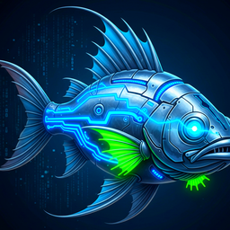

# 🐟 CyberFish

> An entertaining Discord bot to liven up your server.



## Overview

CyberFish is a Discord bot built for fun. Add it to your server to bring a bit of personality and entertainment to your community's chat.

## Features

- Fun, lighthearted commands for your server
- Easy to run yourself and customize
- Simple project layout, so adding new commands is straightforward

## Tech Stack

- Python
- [discord.py](https://discordpy.readthedocs.io/)

## Getting Started

### Prerequisites

- Python 3.10+
- A Discord account and a bot application created in the [Discord Developer Portal](https://discord.com/developers/applications)
- Your bot's token

### Installation

```bash
git clone https://github.com/andrewokun/cyberfish.git
cd cyberfish
pip install -r setup/requirements.txt
```

Setup files and extra instructions are in the [`setup/`](setup) folder.

### Configuration

Create a `.env` file in the project root and add your bot token:

```env
DISCORD_TOKEN=your_bot_token_here
```

Never commit your token. Add `.env` to your `.gitignore`.

### Running the bot

```bash
python src/main.py
```

### Inviting the bot

In the Developer Portal, go to **OAuth2 → URL Generator**, select the `bot` scope plus the permissions you need, and open the generated link to add CyberFish to your server.

## Project Structure

```
cyberfish/
├── images/     # banner and other images
├── setup/      # setup files and instructions
├── src/        # bot source code
├── LICENSE
└── README.md
```

## Contributing

Issues and pull requests are welcome. For larger changes, please open an issue first to discuss what you'd like to change.

## License

Released under the [MIT License](LICENSE) © Andrew Okun.
